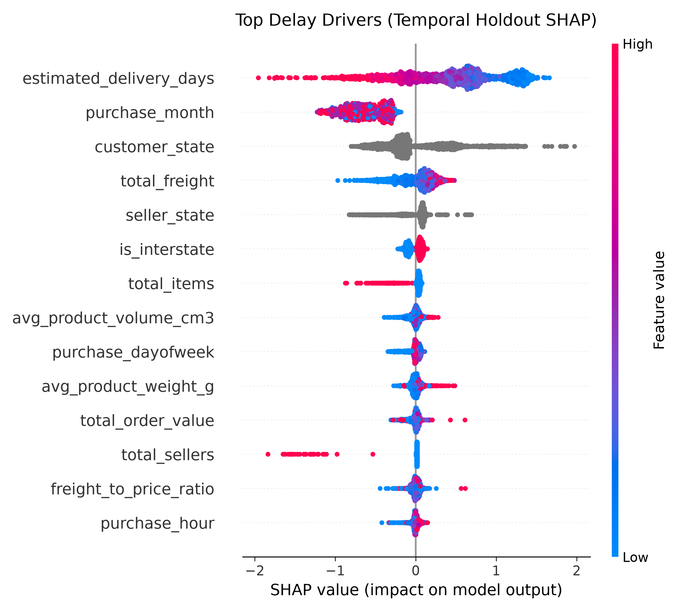

# Late Delivery Risk Prediction & SLA Protection Engine

[](https://www.python.org/downloads/)
[](https://www.sqlite.org/)
[](https://lightgbm.readthedocs.io/)
[](https://shap.readthedocs.io/)

A production-grade Business Analytics & Applied Machine Learning project using the **Olist Brazilian E-Commerce public dataset** (~96.5K delivered orders). 

This project bridges technical data engineering, leak-free machine learning validation, and business translation. It quantifies the customer satisfaction impact of fulfillment failures, constructs an early-warning dispatch model, evaluates the system against a chronological out-of-time holdout, and delivers Agile/CBA specifications for production deployment.

---

## Executive Summary

* **The Problem:** Late deliveries make up **~8.1%** of total fulfilled marketplace volume, but they trigger disproportionate customer friction. When an order arrives late, the average review score drops from **4.29 / 5.0 to 2.57 / 5.0**. In addition, **45.2% of late orders receive a 1-star review** (vs. 6.6% on-time), driving **37.8% of all 1-star reviews** marketplace-wide.
* **The Solution:** A predictive machine learning engine evaluated at checkout time to flag high-risk fulfillment orders *before* carrier pick-up manifests are generated, enabling dynamic SLA buffering and merchant queue prioritization.
* **Methodological Rigor:** Avoided standard random-split leakage and test-set data snooping by implementing an indexed SQLite relational feature pipeline and a **strict 3-way chronological split** (Train 70% / Validation 15% / Test 15%). The tree ensemble size was tuned exclusively against the validation set before a single unbiased evaluation on the out-of-time test holdout.
* **Key Performance:** The final 300-tree LightGBM model achieved an out-of-time **ROC-AUC of 0.7351** and a **PR-AUC of 0.1404** (a **2.12× lift** over the test baseline rate). In an operational top-decile intervention scenario, the model captured **24.56% of all late deliveries** at an internal delay concentration of **16.25%** (a **2.5× risk concentration** over baseline).

---

## Business Problem & Baseline Audit

Marketplace orders with delivery status and review scores were analyzed using deduplicated SQL queries to assess the true relationship between fulfillment performance and customer sentiment:

| Fulfillment Status | Total Delivered Orders | Volume Share | Mean Review Score (CSAT) | 1-Star Review Rate | Platform 1-Star Share |
| :--- | :--- | :--- | :--- | :--- | :--- |
| **On-Time** | ~88,700 | 91.9% | **4.29 / 5.0** | 6.6% | 62.2% |
| **Late** | ~7,800 | 8.1% | **2.57 / 5.0** | **45.2%** | **37.8%** |

Delays are strongly associated with severe customer dissatisfaction. Rather than issuing reactive concessions ($15 refund vouchers) after delivery failures, proactive intervention at order placement can preserve customer lifetime value (LTV) and reduce customer service load.

---

## Data Architecture & Pipeline

The pipeline is split into modular, self-contained Python scripts orchestrated by a master runner:

```
├── data/                                 # Raw CSVs & cached features (git-ignored, .gitkeep tracked)
├── deliverables/                         # Generated artifacts (.gitkeep tracked)
│   ├── Olist_Project_Report.docx         # Complete executive & technical report
│   └── shap_summary_plot.png             # Out-of-time SHAP summary visualization
├── 1_load_db.py                          # Ingests CSVs into indexed SQLite database
├── 2_audit_baseline.py                   # Deduplicated SQL baseline & geographic bottleneck audit
├── 3_feature_engineering.py              # Window-function SQL feature pipeline
├── 4_train_model.py                      # 3-way temporal split & validation tuning pipeline
├── 5_shap_analysis.py                    # Out-of-time TreeExplainer & feature attribution
├── run_pipeline.py                       # 1-click master orchestrator & auto-dependency resolver
├── run_pipeline.bat                      # Windows double-clickable execution script
├── requirements.txt                      # Reproducible library dependencies
├── .gitignore                            # Production gitignore (excludes db, caches, CSVs)
└── README.md
```

### 1. Leakage-Free Feature Engineering (`3_feature_engineering.py`)
All 14 features use data strictly known at purchase completion:
* **Deterministic Primary Seller Selection:** Uses `ROW_NUMBER() OVER (PARTITION BY order_id ORDER BY COUNT(*) DESC, SUM(price) DESC)` to resolve the primary seller state deterministically for multi-item orders.
* **Logistics & Routing:** `is_interstate` (seller state $\ne$ customer destination state), `total_freight`, `freight_to_price_ratio`.
* **Platform Transit Window:** `estimated_delivery_days` (the promised calendar delivery window calculated at checkout).
* **Physical Package Bulk:** Average item weight (`avg_product_weight_g`) and cubic dimensions (`avg_product_volume_cm3`).
* **Cart Complexity:** `total_items`, `total_sellers`, `total_order_value`.
* **Temporal Indicators:** `purchase_month`, `purchase_dayofweek`, `purchase_hour`.

---

## Model Training & Out-of-Time Validation

### Chronological 3-Way Split Structure
To simulate real-world production performance and avoid cross-temporal data leakage:
* **Train Set (70% | 67,517 orders):** September 15, 2016 – April 15, 2018 (Baseline late rate: 9.03%)
* **Validation Set (15% | 14,468 orders):** April 15, 2018 – June 21, 2018 (Baseline late rate: 5.34%)
* **Test Holdout (15% | 14,469 orders):** June 21, 2018 – August 29, 2018 (Baseline late rate: 6.61%)

### Hyperparameter Tuning on Validation Holdout
To prevent test-set overfitting, candidate ensemble sizes were tuned strictly on the validation set using `ROC-AUC`:

| Candidate Trees | Validation ROC-AUC | Status |
| :---: | :---: | :---: |
| 50 | 0.7256 | Evaluated |
| 100 | 0.7316 | Evaluated |
| 150 | 0.7327 | Evaluated |
| 200 | 0.7320 | Evaluated |
| 250 | 0.7326 | Evaluated |
| **300** | **0.7328** | **Selected Optimal Ensemble** |

### Final Out-of-Time Holdout Evaluation
The 300-tree model was scored a single time on the untouched test holdout:

* **ROC-AUC Score:** `0.7351`
* **PR-AUC (Average Precision):** `0.1404` (vs. naive holdout baseline of `0.0661` — a **2.12× lift**)
* **Top 10% Flagged Volume:** 1,446 orders out of 14,469 holdout orders
* **Delays Captured in Top 10%:** 235 orders out of 957 total delays
* **Top Decile Capture Rate:** **24.56%**
* **Delay Risk Concentration:** **16.25%** (a **2.5× concentration** over the 6.61% baseline rate)

---

## Explainability & Root-Cause Analysis (SHAP)

SHAP (`TreeExplainer`) analysis was computed on an out-of-time test holdout sample to isolate the key drivers associated with model delay probabilities:



### Key Analytical Takeaways:
1. **Promised Delivery Windows (`estimated_delivery_days` | Mean \|SHAP\| 0.639):** The strongest driver. Shorter promised windows leave little room for natural transit variance, while longer promised windows absorb shipping anomalies.
2. **Seasonal Delay Patterns (`purchase_month` | Mean \|SHAP\| 0.626):** Ranks as a primary factor; however, because the holdout spans June–August over ~2 years of historical platform data, this feature functions as a seasonal baseline for that operational window.
3. **Geographic Association (`customer_state`, `total_freight`, `seller_state`, `is_interstate`):** Deliveries into remote destination states and shipments crossing interstate boundaries show consistent positive associations with higher delay risk.
4. **Physical & Order Complexity:** Package volume, weight, item counts, and multi-seller splits contribute non-zero signal (mean \|SHAP\| < 0.07), capturing additional handling friction.

---

## Business Impact: Illustrative Cost-Benefit Scenario

*Disclaimer: The following financial projection is an illustrative planning model based on explicit operating assumptions (50,000 annualized orders, $15 concession vouchers, and an assumed 35% delay resolution rate). It provides a business case framework for evaluating intervention viability.*

| Financial & Operational Metric | Baseline Operations | With Proposed Predictive SLA Engine | Net Delta |
| :--- | :--- | :--- | :--- |
| **Annual Order Volume (Assumed)** | 50,000 | 50,000 | — |
| **Baseline Delay Rate (Holdout Period)** | 6.61% (3,305 delays) | 6.61% (3,305 delays) | — |
| **High-Risk Orders Flagged (Top 10%)** | 0 | 5,000 | +5,000 flagged |
| **Expected Delays in Flagged Group (16.25% hit rate)**| 0 | 813 | +813 intercepted |
| **Avoided Delays via Buffer/Routing (35% resolution)** | 0 | 284 | **-284 late orders** |
| **Voucher Concession Savings (@ $15/delay avoided)** | $49,575 | $45,315 | **+$4,260** |
| **Estimated Retained GMV (Assumed 50 retained accounts)**| Baseline | +$17,500 | **+$17,500 ARR** |
| **Cloud Hosting & Inference Costs (Assumed $300/mo)** | $0 | -$3,600 | **-$3,600** |
| **Projected Net First-Year Business Impact** | Baseline | — | **+$18,160** |

---

## Proposed Agile Engineering Specifications

### User Story 1: Real-Time Risk Scoring Ingestion (Proposed)
* **As an** Operations Product Manager,
* **I want** checkout order telemetry scored by the delay prediction service,
* **So that** high-risk shipments can be identified before carrier manifests are generated.
* **Acceptance Criteria:**
  1. Return delay probability within 250ms of order placement.
  2. If the risk score exceeds the top-decile threshold, assign `sla_risk_tier = 'HIGH'`.
  3. System timeout (>500ms) gracefully falls back to `sla_risk_tier = 'STANDARD'` without interrupting customer checkout.

### User Story 2: Merchant Portal Priority Tagging (Proposed)
* **As a** Marketplace Merchant,
* **I want** high-risk shipments highlighted on daily picking lists,
* **So that** time-sensitive orders can be packed and transferred to carriers promptly.
* **Acceptance Criteria:**
  1. Orders marked `sla_risk_tier = 'HIGH'` render with a visible red "Priority Carrier Pickup" badge.
  2. Carrier shipping manifests prepend the prefix `EXP-` to tracking payloads for high-risk parcels.

---

## Getting Started & Reproduction

### Prerequisites
* Python 3.9+ (Standard Python installation; **no Conda required**)

### Installation & Dataset Setup
1. Clone the repository:
   ```bash
   git clone https://github.com/your-username/olist-delivery-risk-engine.git
   cd olist-delivery-risk-engine
   ```

2. Download the [Olist Brazilian E-Commerce Dataset](https://www.kaggle.com/datasets/olistbr/brazilian-ecommerce) from Kaggle and place all uncompressed `.csv` files into the `data/` directory.

### Running the End-to-End Pipeline (1-Command Execution)

Run the master orchestrator script directly in your terminal:

```bash
python run_pipeline.py
```

*What `run_pipeline.py` does automatically:*
1. **Dependency Verification:** Inspects `requirements.txt` and automatically installs or verifies any missing packages (`lightgbm`, `shap`, `pandas`, `scikit-learn`, `matplotlib`, `python-docx`) using `pip`.
2. **Database Ingestion (`1_load_db.py`):** Loads all raw CSVs into an indexed relational SQLite database (`olist.db`).
3. **Baseline Business Audit (`2_audit_baseline.py`):** Computes deduplicated order-level CSAT drops, 1-star distributions, and geographic risk concentrations.
4. **Feature Engineering (`3_feature_engineering.py`):** Executes SQL window functions to resolve primary seller states deterministically, computes order-level logistics ratios, and caches `training_features.csv`.
5. **Validation Tuning & Testing (`4_train_model.py`):** Partitions data chronologically (70/15/15), selects the optimal tree ensemble size on the validation set (300 trees), and produces unbiased holdout test scores and top-decile metrics.
6. **SHAP Attribution (`5_shap_analysis.py`):** Fits TreeExplainer to the holdout test set, outputs ranked mean absolute SHAP values, and exports `deliverables/shap_summary_plot.png`.

> **Windows 1-Click Alternative:** You can also double-click `run_pipeline.bat` from File Explorer to execute the entire end-to-end pipeline in a single click.

---

### Step-by-Step Manual Execution (Optional)
If you prefer running individual stages manually instead of using `run_pipeline.py`:

```bash
pip install -r requirements.txt

python 1_load_db.py
python 2_audit_baseline.py
python 3_feature_engineering.py
python 4_train_model.py
python 5_shap_analysis.py
```

---

## License
This project is open-source and available under the [MIT License](LICENSE).